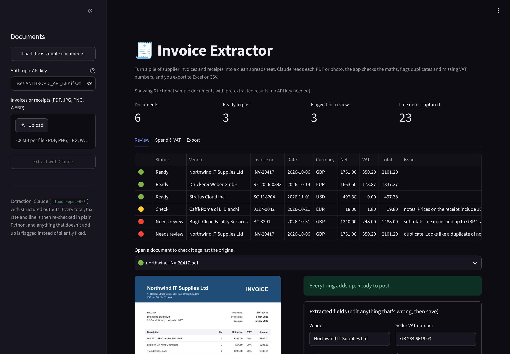
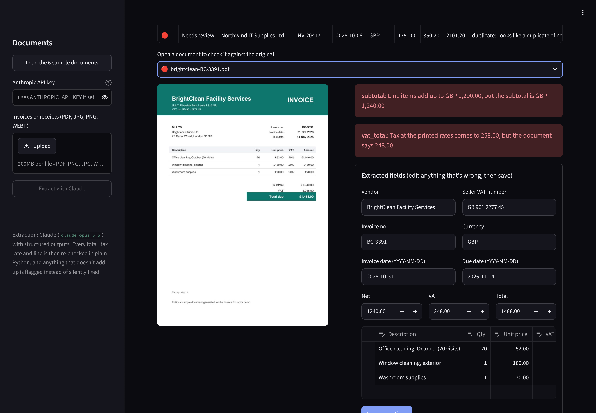
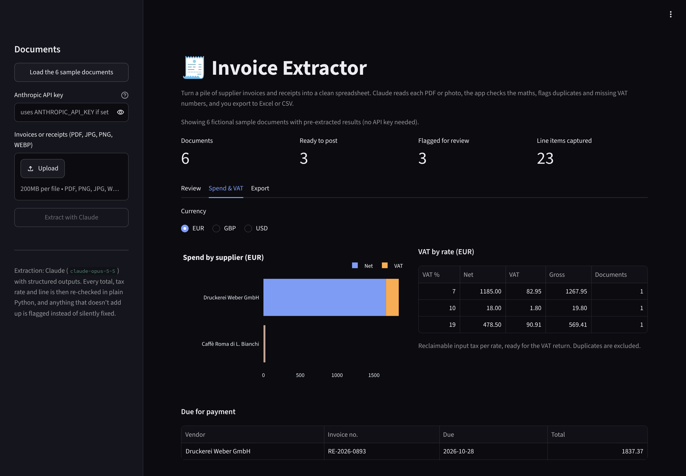
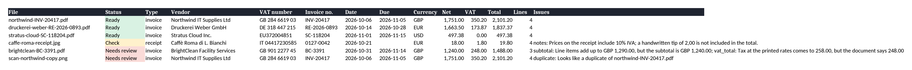

# Invoice Extractor

**Turn a pile of supplier invoices and receipts into a clean, checked spreadsheet.** Drop in PDFs or phone photos, Claude reads the vendor, dates, VAT number, line items and totals, the app re-checks every number, flags duplicates and anything that doesn't add up, and you download an Excel workbook or CSV ready for your accounting software.

**[▶ Live demo](https://fahadasad10.github.io/invoice-extractor/)** (runs in your browser with 6 sample documents, no API key needed; first load takes about a minute)



## The business problem

Small businesses and bookkeepers still type invoices into spreadsheets by hand: vendor, invoice number, date, net, VAT, total, often line by line. It's slow, and the expensive mistakes are the quiet ones: a supplier invoice paid twice, a total that doesn't match its lines, VAT reclaimed on an invoice with no VAT number.

Invoice Extractor does the typing and, more importantly, the checking:

| What it catches | Example in the sample set |
| --- | --- |
| Lines that don't add up to the subtotal | BrightClean: lines total £1,290.00, invoice says £1,240.00 |
| VAT that doesn't match the printed rates | BrightClean: 20% of the lines is £258.00, invoice says £248.00 |
| Duplicates, even as a different file | A scanned copy of a Northwind invoice already in the batch |
| Missing seller VAT number, invoice number or date | Flagged as "Check" before you reclaim VAT |
| Due date before invoice date, future dates, quantity × price mismatches | Covered by tests |

Claude reads, plain Python does the maths. The model is told to **copy numbers exactly as printed and never correct them**, so an error on the invoice shows up as a flag for a human instead of being silently "fixed".

## Features

- **PDFs, scans and phone photos** (PDF, JPG, PNG, WEBP), several at once, processed in parallel
- **Any layout, any language**: the prompt handles European number formats (1.234,56) and day/month order; the sample set includes an English invoice, a German one with mixed 19% / 7% VAT and a photographed Italian receipt
- **Structured outputs**: Claude returns a typed `Invoice` (Pydantic) that is validated by the API, so there is no fragile JSON parsing
- **Review screen**: every document side by side with what was extracted, status (🟢 Ready, 🟡 Check, 🔴 Needs review) and the reason, with editable fields and line items that re-check as soon as you save
- **Spend & VAT**: spend per supplier, VAT per rate (what a VAT return needs) and what's due for payment, per currency
- **Exports**: a formatted Excel workbook with three sheets (Invoices, Line items, VAT summary; frozen headers, filters, colour-coded status) plus CSV files in the flat one-row-per-line shape that Xero, QuickBooks and Sage imports expect
- **Sample mode**: six fictional documents with pre-extracted results, so anyone can try the review and export flow without an API key

| Check a flagged invoice against the original | Spend and VAT by rate |
| --- | --- |
|  |  |

The exported workbook (Invoices sheet):



## How it works

```
PDF / photo ──▶ Claude (claude-opus-5-5)          ──▶ Invoice (Pydantic)  ──▶ checks in Python     ──▶ review + edit ──▶ Excel / CSV
               document or image block                vendor, VAT no.,         lines = subtotal?
               messages.parse(output_format=Invoice)  dates, currency,         net + VAT = total?
               "copy numbers, never fix them"         line items, totals       VAT at printed rates?
                                                                               duplicates, missing IDs
```

1. **Read** (`invoice_extractor/extract.py`): each file becomes a `document` block (PDF) or `image` block (photo) and goes to `client.beta.messages.parse()` with `output_format=Invoice`. Server-side refusal fallbacks are on, and a refusal or truncated answer raises a clear error for that file only; the rest of the batch carries on.
2. **Check** (`invoice_extractor/validate.py`): quantity × unit price per line, lines vs subtotal, subtotal + tax vs total, tax recomputed from the printed rates, date sanity, missing invoice / VAT numbers, and duplicates across the batch (same vendor + number, or same vendor + date + amount, with names normalised so "ACME LIMITED" matches "Acme Ltd"). Tolerances allow a cent of rounding per line.
3. **Export** (`invoice_extractor/export.py`): pandas tables written with openpyxl formatting. CSVs carry a UTF-8 BOM so Excel shows "Broschüre" and "Caffè" correctly.

## Tech stack

Python 3.13 · Anthropic Python SDK (`claude-opus-5-5`, structured outputs, PDF and vision input) · Pydantic · pandas · openpyxl · Streamlit · Plotly · pytest · ruff · Docker · GitHub Actions · stlite (in-browser demo)

## Run it

```bash
git clone https://github.com/FahadAsad10/invoice-extractor.git
cd invoice-extractor
python -m venv .venv && source .venv/bin/activate
pip install -r requirements.txt
export ANTHROPIC_API_KEY=sk-ant-...   # or paste it in the sidebar
streamlit run app.py                  # http://localhost:8501
```

Or with Docker:

```bash
docker build -t invoice-extractor .
docker run -p 8501:8501 -e ANTHROPIC_API_KEY=sk-ant-... invoice-extractor
```

Use it from Python, e.g. in a nightly job that reads a mailbox folder:

```python
from pathlib import Path
from invoice_extractor.extract import extract_many
from invoice_extractor.export import review, to_excel

files = [(p.name, p.read_bytes()) for p in Path("inbox").glob("*.pdf")]
results = extract_many(files)
rows = review([(name, inv) for name, inv, err in results if inv])
Path("invoices.xlsx").write_bytes(to_excel(rows))
```

## Tests

```bash
pip install -r requirements-dev.txt
ruff check . && pytest -q
```

23 tests cover the checks (including rounding, mixed VAT rates and VAT-inclusive receipts), the request sent to Claude (model, schema, fallbacks, PDF vs image blocks, refusals, one failing file in a batch), the Excel and CSV exports, and the app itself (it renders without a key, and correcting a flagged invoice clears the error). CI runs lint, tests and a Docker build with a health check on every push.

## Project structure

```
app.py                       # Streamlit app: review, spend & VAT, export
invoice_extractor/
  schema.py                  # Invoice and LineItem models (the structured output)
  extract.py                 # Claude call, PDF/image blocks, parallel batch
  validate.py                # arithmetic, VAT, dates, missing IDs, duplicates
  export.py                  # tables, Excel workbook, CSV
  samples.py                 # the six sample documents as data
samples/                     # rendered sample PDFs and photos (+ make_samples.py)
tests/
```

## Next steps

- Watch an email inbox or Google Drive folder and process new invoices automatically
- Push approved invoices straight to Xero or QuickBooks through their APIs
- Remember each supplier's usual VAT rate and account code to pre-fill coding

## License

MIT, built by Fahad Shaikh with [Claude Code](https://claude.com/claude-code). The sample companies and documents are fictional.
